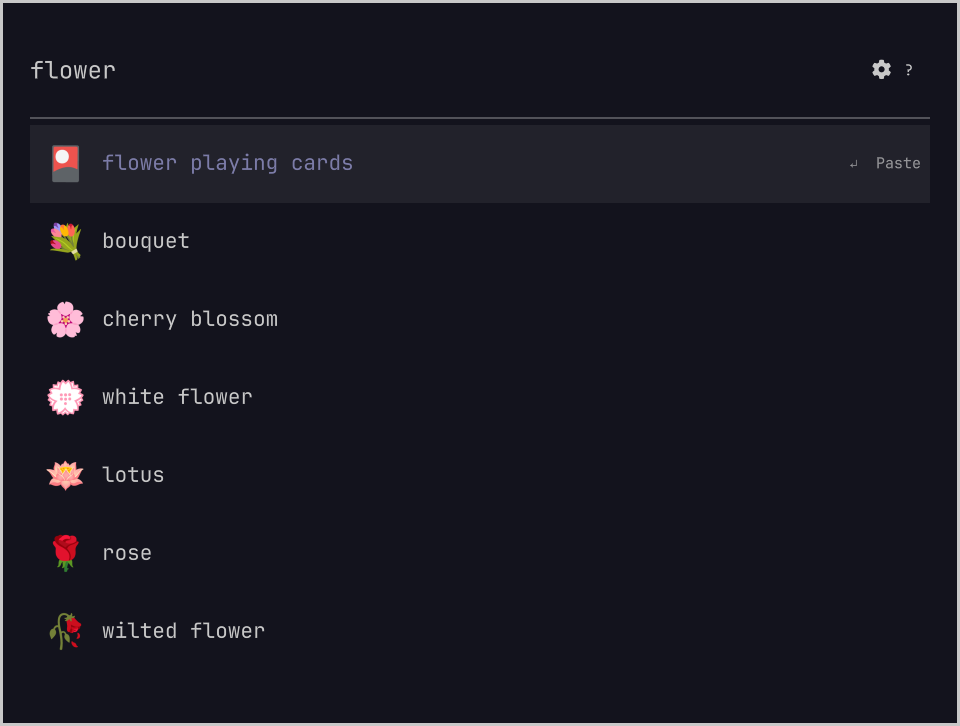
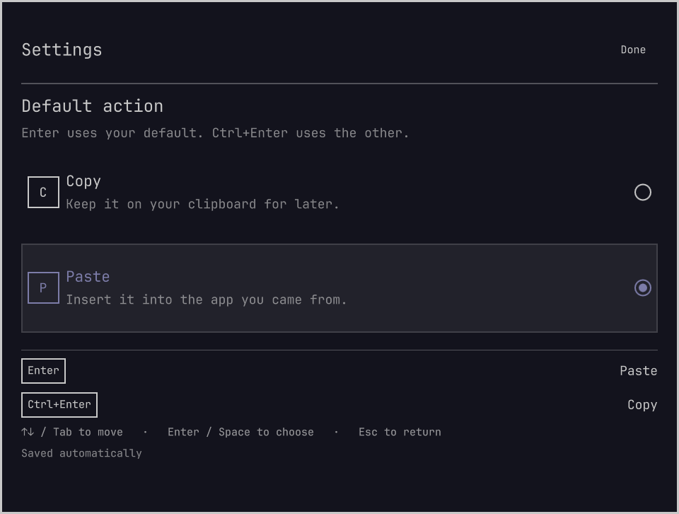

# omoji

An emoji picker for [Omarchy](https://omarchy.org) that learns your choices.

Type `flower`, choose wilted flower, and it comes first the next time you search `flower`. No aliases to set up. Just pick what you mean.

| Your first search | The next time |
| --- | --- |
|  |  |

- **Learns each search.** Your choice for `flower` stays separate from your choice for `heart`.
- **Remembers recent picks.** Open it without typing to find the emojis you used last.
- **Copies or pastes.** Choose what Enter does. Ctrl+Enter does the other action.
- **Fits your desktop.** Native Quickshell UI, your Omarchy theme, and no extra background service.

[Raycast](https://www.raycast.com/)-style emoji search for Omarchy, inspired by [Omacast](https://github.com/typecraft-dev/oma-cast).

## Install

[View omoji in the plugin marketplace](https://plugins.omarchy.org/plugin.html?id=akshar.omoji), or install it directly:

```sh
omarchy plugin add https://github.com/AksharP5/omoji --enable
```

Press **Ctrl+Super+E**, type a search, and press **Enter** to use the selected emoji.
Use **Up/Down** to move through results, or click one.

The existing emoji shortcut and Omarchy menu action open omoji automatically. If you already use another replacement for `omarchy.emojis`, disable that plugin first with `omarchy plugin disable <its-id>`.

Tested on Omarchy **4.5.0** and **4.0.0.r7396.g526fe64-1**. Uses the Quickshell, Bash, `wl-copy`, `wl-paste`, coreutils, and `wtype` that Omarchy includes. No build step or additional packages.

## Make Enter work your way

Press **?** or click the **gear** beside search. Click **Copy** or **Paste**, or press **C** or **P**. Your choice saves immediately and the menu closes, returning you to the same search.



| Default | Enter or click | Ctrl+Enter |
| --- | --- | --- |
| Paste | Paste into the app you came from | Copy to clipboard |
| Copy | Copy to clipboard | Paste into the app you came from |

Paste is the initial default. **Esc**, **?**, or a click outside the menu closes it without changing your preference.

Pasting sends **Shift+Insert** after the picker closes, as Omarchy does. The emoji also stays on the clipboard. If your app does not accept Shift+Insert, use Copy and your app's paste shortcut instead.

## Keyboard

| Key | Action |
| --- | --- |
| Ctrl+Super+E | Open the picker |
| Type | Search English names and keywords |
| Up / Down | Select a result |
| Ctrl+N / Ctrl+P | Next / previous result |
| Page Up / Page Down | Move a page |
| Enter | Use your default action |
| Ctrl+Enter | Use the opposite action for this pick |
| ? / Ctrl+, | Open or close settings |
| Esc | Leave settings, clear the search, then close |

In settings, **C** selects Copy and **P** selects Paste and returns to the picker. You can also use **Up/Down** or **Tab**, then **Enter** or **Space** to apply the highlighted choice and return. Emoji actions are suspended while the menu is open.

## Learning and privacy

The choice you use most for a search comes first. Your most recent choice breaks a tie. Searches ignore case and repeated spaces. Browsing results or closing the picker does not teach it a preference.

Everything stays on your machine. No account, telemetry, or runtime network requests. Emoji names and keywords are English; interface text follows Omarchy's language fallback.

Search accepts up to 160 characters. Longer queries remain editable; shorten them to select a result. Clipboard text is read only when you paste, in a separate process with a one-second timeout and a 641-byte transfer limit. Oversized or stalled pastes leave your search unchanged and show a warning.

<details>
<summary>Local files and manual configuration</summary>

Preferences: `${XDG_CONFIG_HOME:-~/.config}/omoji/config.json`

```json
{ "version": 1, "defaultAction": "paste" }
```

Use `"copy"` for a copy default. Changes are picked up automatically. Invalid preferences are left untouched; omoji falls back to copying and shows a warning.

Learning: `${XDG_STATE_HOME:-~/.local/state}/omoji/history.json`

The history keeps the 2,000 most recent search/emoji pairs. Files use mode `0600`, directories `0700`, and writes are atomic. Unreadable history is preserved and disables learning while copy and paste keep working. To reset learning, close the picker, rename the history file, and restart the Omarchy shell.

Only completed copy or paste commands teach the picker. It cannot detect whether an application accepts Shift+Insert. If a paste command fails, the picker returns with an error and the emoji remains on the clipboard.

</details>

## Update or remove

```sh
omarchy plugin update akshar.omoji
```

If the shell retains an older interface after updating, run `omarchy restart shell`.

```sh
omarchy plugin remove akshar.omoji
```

Omarchy restores its built-in picker. Your preferences and learning history are kept. If you disabled another replacement yourself, re-enable it to return to that picker.

## Contributing

See [the development guide](docs/development.md) for tests, isolated previews, and compatibility checks.

## License

[MIT](LICENSE). Built on [Omarchy](https://github.com/omacom/omarchy), copyright David Heinemeier Hansson, under [its MIT license](LICENSE-OMARCHY). English names and keywords come from [Unicode CLDR](https://github.com/unicode-org/cldr-json) under the [Unicode license](LICENSE-UNICODE).
