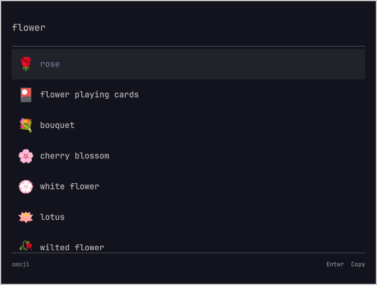

# omoji

A native emoji picker for [Omarchy](https://omarchy.org) that remembers what you mean.
Inspired by [Omacast](https://github.com/typecraft-dev/oma-cast): fast keyboard search, learned choices, and your desktop's theme.

Search `flower`, choose rose, and rose comes first the next time you search `flower`.
Learning stays specific to that search. The most-used choice wins; the most recent choice breaks ties.
Opening the picker without a search shows your recent choices first.



## Install

Requires Omarchy **4.5.0**, its Quickshell shell, Bash, and `wl-copy`, which Omarchy includes.
There are no runtime downloads or extra background services. Node and Python are development tools only.

```sh
omarchy plugin add https://github.com/AksharP5/omoji --enable
```

Press **Ctrl+Super+E**. The plugin replaces `omarchy.emojis` through Omarchy's plugin API, so the existing shortcut and Emoji menu action open it. No Hyprland configuration edits are needed.

If you already use another replacement for `omarchy.emojis`, disable that plugin first with `omarchy plugin disable <its-id>`. Omarchy can route the built-in shortcut to only one replacement.

Update with `omarchy plugin update akshar.omoji`.

## Keyboard

| Key | Action |
| --- | --- |
| Type | Search English names and keywords |
| Up / Down | Select a result |
| Ctrl+N / Ctrl+P | Next / previous result |
| Page Up / Page Down | Move a page |
| Enter | Copy the selected emoji and remember the choice |
| Esc | Clear the search, then close |

Clicking a result copies it too. Paste it wherever you want with your application's paste shortcut.
Only successful copies teach the picker. Moving through results and dismissing it do not count.

## How learning works

Searches ignore case and repeated spaces. Each search and emoji pair has a use count and last-used time.
Choices for `flower` have no effect on the order for `heart`. Exact name matches come before keyword matches when there is no learned preference.
The picker keeps the 2,000 most recently used search and emoji pairs. This first version has no account, telemetry, or network access.

History is stored in `${XDG_STATE_HOME:-~/.local/state}/omoji/history.json` in a private directory with mode `0700`; the file has mode `0600`.
Writes are atomic. An unreadable file or an unknown history version disables learning and leaves the file untouched, while copying keeps working.

## Remove

```sh
omarchy plugin remove akshar.omoji
```

Omarchy restores the built-in picker if this plugin disabled it. If you disabled another replacement yourself, re-enable that plugin to return to it.
Your learning history is kept. To reset it, close the picker, rename its history file, then restart the Omarchy shell.

## Development

```sh
git clone https://github.com/AksharP5/omoji
cd omoji
node --test tests/search.test.js
omarchy plugin validate .
python scripts/native-test.py
python scripts/preview.py
```

The native tests and preview require a running Omarchy Wayland session. They use a temporary shell host and temporary history, so they do not install the plugin or change your shortcut. Native tests replace the clipboard command, suppress window visibility, and exercise real QML and disk writes. They check persistence across restarts, private permissions, failed and missing clipboard commands, reopening during a copy, and corrupt history.

`OMARCHY_PATH=/path/to/omarchy python scripts/native-test.py` checks against another Omarchy source checkout. Verified with the **v4.5.0** shell components and the installed **4.0.0.r7396.g526fe64-1** development build, using Quickshell **0.3.2.r7**. This does not claim compatibility with earlier stable Omarchy releases.

Capture an isolated sample without changing real learning:

```sh
python scripts/preview.py --query flower --capture /tmp/before.png
python scripts/preview.py --query flower --learn rose --capture /tmp/after.png
```

`python scripts/update-data.py` rebuilds the bundled 1,870-emoji catalog from pinned Omarchy v4.5.0 and Unicode CLDR 48 data. This development command downloads public data; the picker itself works offline. UI strings use Omarchy's live language fallback, with English included. Emoji names and keywords are English in this version.

## Credits and license

MIT. The emoji catalog and native shell integration build on [Omarchy](https://github.com/omacom/omarchy), copyright David Heinemeier Hansson, under [its MIT license](LICENSE-OMARCHY). English names and extra keywords come from [Unicode CLDR](https://github.com/unicode-org/cldr-json) under the [Unicode license](LICENSE-UNICODE). Omacast inspired the interaction; this is a separate project.
